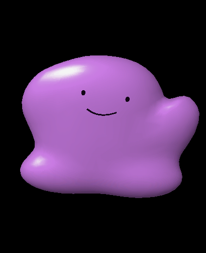
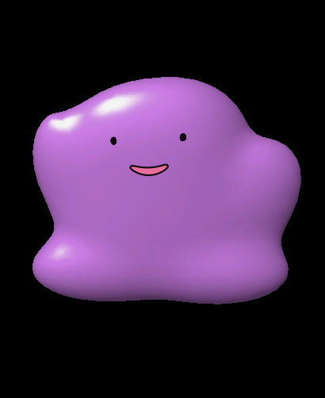

# Ditto OS

A tiny, expressive desk companion built on the **Waveshare ESP32-S3 Touch AMOLED 2.06**. Live 3D jelly physics, a touch-and-motion-driven character, and a macOS dictation remote—all running on a microcontroller.

This is the public engineering source for the project previously named **Scout OS**. It builds on ESP-IDF / FreeRTOS; it is not a new bare-metal kernel.

<p align="center">
  
  
  
</p>

## What is here

- Native **410 × 502** software rendering: smooth shaded geometry, liquid deformation, lighting, expressive face, and a small live animation rig. No prerecorded playback on the device.
- Touch impulses, dragging, motion-driven inertia, gravity, sleep/wake, and brightness transitions.
- Clock and settings UI, microphone/speaker services, Wi-Fi actions, and a small app/skill foundation.
- USB microphone plus the **Ditto Remote** macOS helper: hold to trigger Wispr Flow, release to finish, double-tap Return, shake for guarded Undo.
- Encrypted BLE controls and microphone transport, battery/workload journaling, native tests, asset generators, and hardware measurement notes.
- [Emote video contact sheet](docs/emotes/) and [hardware inventory](docs/hardware/WHAT-WE-HAVE.md).

## Status

Source baseline: **firmware 0.11.56 / macOS helper 0.3.0**. This is an experimental personal project, not a finished consumer OS.

USB dictation has been exercised on real hardware. Version 0.11.56 fixes corrupted USB samples under the helper/Bluetooth workload by keeping the Bluetooth controller and host on core 0 and USB on core 1. Native repeated captures returned to the clean baseline; fresh human transcription confirmation remains pending.

Bluetooth controls and encoded microphone packets have been tested. Complete wireless microphone routing through BlackHole into Wispr Flow, physical unplug testing, and a full battery discharge cycle remain unfinished. A cloud language model / live voice agent has **not** been connected. The voice adapter and local action interface are provided for that future work.

Animation targets 30 FPS; measured rates depend on workload. Recent combined audio/Bluetooth intervals were around **28 FPS**, so this is not a blanket claim of sustained 30 FPS with headroom.

## Build the firmware

Install [ESP-IDF **v5.5.5**](https://github.com/espressif/esp-idf/tree/v5.5.5) with its ESP32-S3 tools. Set `IDF_PATH` to that checkout, and `IDF_TOOLS_PATH` if using a non-default tools directory. A clean source build downloads the exact components pinned in `main/idf_component.yml` and `dependencies.lock`.

```sh
git clone https://github.com/leo4life2/ditto-os.git
cd ditto-os
export IDF_PATH="$HOME/esp/esp-idf"
bash build.sh build
```

The current procedural avatar and generated font data are included. To flash **this Waveshare board**, find its serial port and use:

```sh
bash build.sh -p /dev/cu.usbmodemYOUR_DEVICE flash
# Linux typically uses /dev/ttyACM0.
```

Flashing replaces firmware. Stop any bridge/helper holding the port first. The board may need BOOT/download mode. The build wrapper records source and artifact hashes before permitting a flash; do not reuse another build's binaries or configuration.

## Host tools and macOS helper

Use Python 3.11+ for the host tooling and the Python version supported by ESP-IDF for firmware builds:

```sh
python3 -m venv .venv
.venv/bin/python -m pip install -r requirements-dev.txt
.venv/bin/python host/bridge.py
```

The console is at `http://127.0.0.1:8781`. The bridge intentionally stays on loopback. One process must own the USB serial connection.

On macOS with Xcode Command Line Tools installed:

```sh
.venv/bin/python tools/build_mac_remote.py --stage-only
# Review the signed/self-tested bundle before installing:
.venv/bin/python tools/build_mac_remote.py
open '/Applications/Ditto Remote.app'
```

The default install location is `/Applications/Ditto Remote.app`. No login item is added. See [helper setup](host/mac-remote/README.md) for permissions, Python environment lifetime, and audio routing. Select **Ditto Microphone** in Wispr Flow for USB dictation.

## View the animations

```sh
python3 -m http.server 8782 --bind 127.0.0.1 --directory docs/emotes
```

Open `http://127.0.0.1:8782`. These review videos were produced with the native renderer on the Mac; the device itself animates live. They document the approved rig/emotes, not every subsequent firmware change.

## Test without hardware

```sh
.venv/bin/python tools/check_public_source.py
```

This runs selected production physics, input, audio-buffer and protocol tests without flashing, recording audio, injecting keys, or contacting an AI service. Hardware and historical experiment scripts are also retained in `tests/` and `tools/`; scripts named `hardware`, `flash`, `probe`, or `qualification` may interact with a connected device. Read them before running them.

## Project map

| Path | Contents |
| --- | --- |
| `main/` | Firmware, physics, face/rig, audio, UI, power and transport |
| `components/a3d/` | Modified a3d software renderer, Apache-2.0 |
| `host/` | Serial bridge, voice/action interface and native macOS helper |
| `assets/` | Procedural avatar, alternate authored/CC0 models, fonts |
| `tools/` | Asset generation, render review, builds and diagnostics |
| `tests/` | Native, host and hardware test sources |
| `hardware/diagnostic/` | Original board bring-up source, retained as history |
| `docs/hardware/` | Board inventory, measurements, pin-map notes and safe area |
| `docs/emotes/` | Self-contained video contact sheet |

Start with [app development](APP-DEVELOPMENT.md), [rig and emotes](RIG-AND-EMOTES.md), [motion physics](MOTION-PHYSICS.md), [voice/remote](FLOW-REMOTE.md), and [wireless/battery architecture](WIRELESS-AUDIO-AND-BATTERY.md).

The longer [engineering notes](ENGINEERING-NOTES.md), [work log](WORK-STATUS.md), and other dated reports preserve historical results. Their old versions, workspace paths and references to private `test-results/` archives do not describe a current release. Those raw captures and machine-local archives are intentionally not published. Some historical modeling/probe recipes require separately supplied input assets or the original workspace layout.

## Attribution and licensing

See [THIRD-PARTY.md](THIRD-PARTY.md) for upstream source and asset notices. The procedural Ditto character is an unofficial Pokémon fan prototype; Pokémon/Ditto names and character rights belong to their respective owners. This repository is not affiliated with or endorsed by them. No downloaded Pokémon artwork or licensed Labubu/Gundam printing mesh is included.

No project-wide license has been selected for original project code. Publishing the repository does not change the licenses of its third-party components or grant rights to third-party characters.
